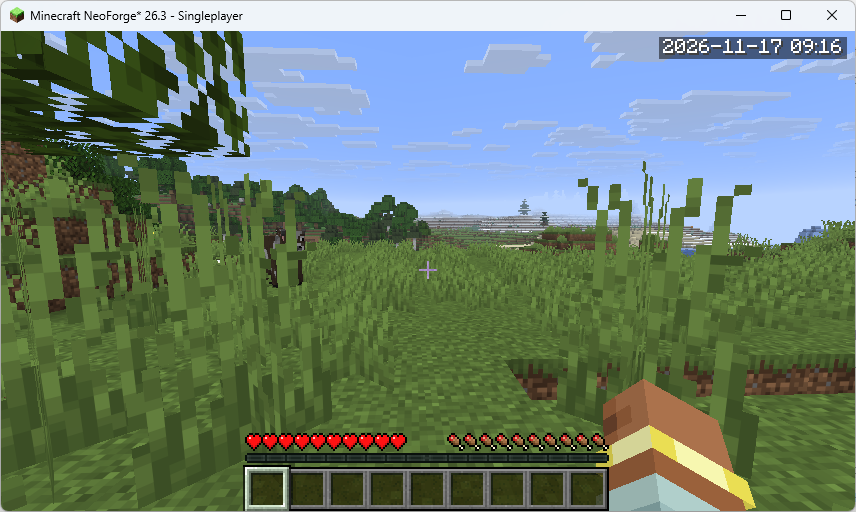

# NeoForge Clock

A tiny NeoForge mod for Minecraft **26.3** that shows the real-world clock in the
top-right corner of the screen, formatted as `yyyy-MM-dd HH:mm`.

## What it does

- Draws a HUD layer above every other HUD layer (crosshair, hotbar, chat, tab list, ...).
- Uses the machine's local time, re-read every frame, so the displayed minute always
  matches the system clock.
- Very cheap: no ticking logic, no config, no server-side code — rendering is one text
  draw plus one translucent backdrop rectangle per frame.



## Requirements

| Item          | Version        |
| ------------- | -------------- |
| Minecraft     | 26.3           |
| NeoForge      | 26.3.0.103 or newer (loader `[4,)`) |
| Java          | 25             |

## Installation

1. Build the jar (see below) or grab it from the releases page.
2. Drop `clock-<version>.jar` into the `mods/` folder of a NeoForge 26.3 client.
3. Start the game — the clock appears in the top-right corner of the HUD.

The mod is client-side: it renders the local clock of the player's computer, so it does
not need to be installed on the server.

## Building from source

```bash
./gradlew build
```

The jar is written to `build/libs/clock-1.0-SNAPSHOT.jar`.

To try it inside a dev client:

```bash
./gradlew runClient
```

## Project layout

| Path | Purpose |
| ---- | ------- |
| `src/main/java/cn/ac/micphone/clock/Clock.java` | `@Mod` entry point, logs the mod id on load |
| `src/main/java/cn/ac/micphone/clock/ClockHudLayer.java` | `GuiLayer` implementation, registered through `RegisterGuiLayersEvent` |
| `src/main/templates/META-INF/neoforge.mods.toml` | mod metadata template, expanded by `generateModMetadata` |
| `gradle.properties` | Minecraft / NeoForge / mod metadata versions |

## Notes about this build setup

- Gradle wrapper 9.2.1, Java toolchain 25, `net.neoforged.moddev` 2.0.148.
- `rootProject.wrapper` resolves the toolchain via the foojay resolver 1.0.0 (Gradle 9
  requires that version; 0.8.0 breaks with `NoSuchFieldError: JvmVendorSpec IBM_SEMERU`).
- `gradlew.bat` falls back to a local JDK 25 when `JAVA_HOME` is not defined.
- `gradle.properties` contains `systemProp.*.proxy*` entries used on the machine this mod
  was developed on; remove them if you build behind a different network.

## License

[MIT](LICENSE) © 2026 Micphone
